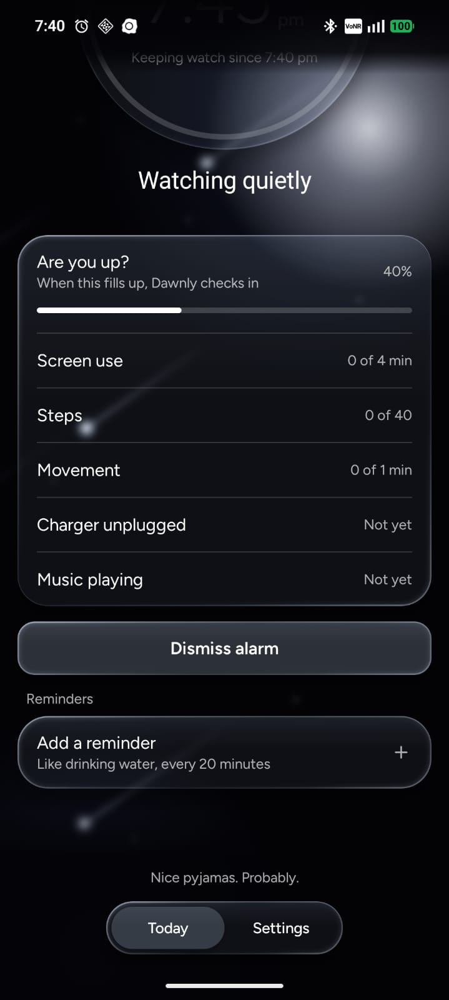
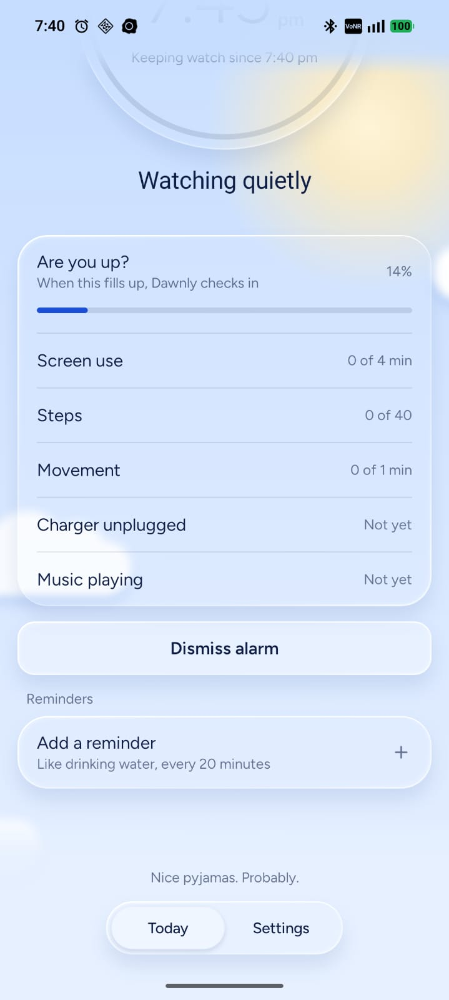

# Dawnly website

**The place where you download Dawnly.**

Dawnly is an Android app that notices you're already up and turns your alarm off before it rings. This repo is the website that hosts it.

**[Visit the site →](https://dawnly-website.pages.dev)** · [Privacy policy](https://dawnly-website.pages.dev/privacy)

<p align="center">
  
  
</p>

## Why this exists

I built Dawnly and wanted people to actually be able to use it. Then I looked at publishing it on the Play Store. It wants a paid developer account, and for a lot of setups, a registered business too. For a free app made by one person, that's a lot.

So I made this site instead. It hosts the signed APK, walks you through installing it, and shows how many people have downloaded it. That's the whole job.

| | This site | Play Store |
| --- | --- | --- |
| Cost to publish | Free | Paid developer account |
| Business account needed | No | Often, yes |
| Install | Download the APK, tap it, allow the source | One tap |
| Updates | Download the new APK from here | Automatic |

Installing from a file is a bit more work, and Android will warn you because the app isn't from the Play Store. That warning is normal for any APK. The site explains each step.

## What's on the site

- **The download.** One signed APK, always the latest version. The version number and file size on the page are read straight from the APK, so they can't be out of date.
- **A download counter.** A public total that goes up when someone confirms a download. See below for what the number means.
- **Install and setup steps.** What to tap, and what to allow once Dawnly is on your phone.
- **A privacy page.** Plain words about what the app and this site do and don't store.
- **Light and dark mode.** Dark is the default, and your choice is remembered.

## About the download counter

The number is the count of people who tapped **Yes, download it**. It is not the number of installs. I can't see installs without putting tracking inside Dawnly, and Dawnly is offline and private on purpose, so I'm not doing that.

It stores one number. No IP addresses, no cookies, nothing about you. If you want the full picture, it's in [docs/architecture.md](docs/architecture.md).

It's also not tamper-proof. The site ignores requests from other websites, but someone sending requests directly could still bump it. Think of it as a friendly indicator, not an audit.

## Tech stack

| Area | Tools |
| --- | --- |
| Site | Plain HTML, CSS and JavaScript modules. No framework, no build step |
| Hosting | [Cloudflare Pages](https://pages.cloudflare.com) |
| Counter | One Pages Function backed by [Cloudflare D1](https://developers.cloudflare.com/d1/) (a single row) |
| Tooling | [Wrangler](https://developers.cloudflare.com/workers/wrangler/) for local dev and deploys, plus a small Node script that reads the APK |

## How it's organised

Big files get split into small ones, so every file does one thing.

```
public/                 Everything the site serves
  index.html            The page itself (markup only)
  privacy.html          The privacy policy
  css/                  One small stylesheet per section of the page
  js/                   Small modules: theme, version info, counter, download dialog
  images/               The logo and app screenshots
  downloads/            The APK (always exactly one file)
  _headers              Makes the APK download correctly on Android
functions/api/          The counter's API route
server/                 Helpers that route uses
migrations/             The database setup
scripts/                The release script, which reads the APK and updates the page
docs/                   How it works, and how to run it
```

## Run it locally

You need [Node.js](https://nodejs.org) 20 or newer.

```bash
npm install
npm run db:migrate:local
npm run dev
```

Then open [http://localhost:8788](http://localhost:8788). The counter works locally too, using a throwaway database on your machine.

| Command | What it does |
| --- | --- |
| `npm run dev` | Run the site and the counter locally |
| `npm run db:migrate:local` | Set up the local database (first time only) |
| `npm run sync-apk` | Read the APK and update the version and size on the page |
| `npm run deploy` | Sync the APK, then publish to Cloudflare |

## Releasing a new version

1. Build the signed release APK.
2. Drop it into `public/downloads/`. The file name doesn't matter.
3. Run `npm run deploy`.

The script reads the version from the APK, renames the file, removes the old one, updates the page and publishes. The full runbook (resetting the counter, backups, troubleshooting) is in [docs/operations.md](docs/operations.md).

## Feedback

Found a bug, or have a thought? Email me at [redischarmender@gmail.com](mailto:redischarmender@gmail.com?subject=Dawnly%20feedback), or [open an issue](https://github.com/AryanLanke/dawnly-firstlight/issues/new). For security problems, see [SECURITY.md](SECURITY.md).

## License

The website's code is [MIT](LICENSE). The Dawnly name, logo, screenshots and the app itself are not covered by that license and stay mine.
