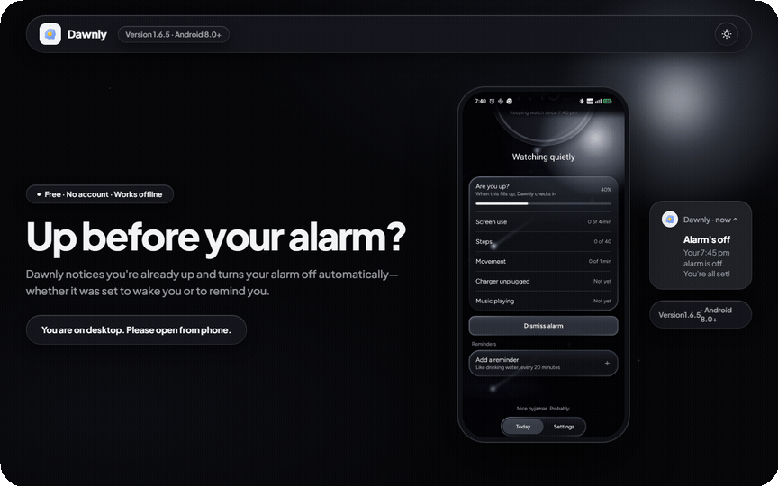
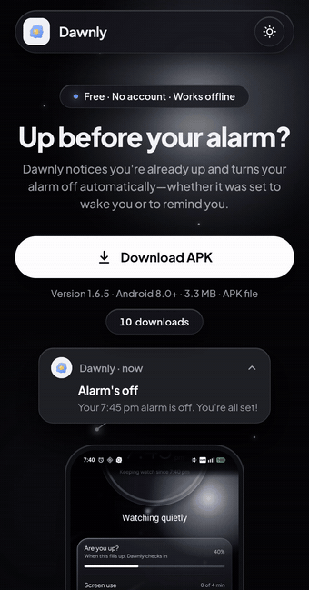

# Dawnly website

**The place where you download Dawnly.**

Dawnly is an Android app that notices you're already up and turns your alarm off before it rings. This repo is the website that hosts it.

**[Visit the site →](https://dawnly-website.pages.dev)** · [Privacy policy](https://dawnly-website.pages.dev/privacy)

  
  

**Heads up: Dawnly is a phone app.** Open the site on your Android phone to download it. On a computer, the download button is hidden and the page asks you to open it on your phone instead.

## Why this exists

I built Dawnly and wanted people to actually be able to use it. Then I looked at publishing it on the Play Store. It wants a paid developer account, and for a lot of setups, a registered business too. For a free app made by one person, that's a lot.

So I made this site instead. It hosts the signed APK and walks you through installing it. That's the whole job.

| | This site | Play Store |
| --- | --- | --- |
| Cost to publish | Free | Paid developer account |
| Business account needed | No | Often, yes |
| Install | Download the APK, tap it, allow the source | One tap |
| Updates | Download the new APK from here | Automatic |

Installing from a file is a bit more work, and Android will warn you because the app isn't from the Play Store. That warning is normal for any APK. The site explains each step.

## What's on the site

- **The download.** One signed APK, always the latest version. The version number and file size on the page are read straight from the APK, so they can't be out of date. It only shows up on phones.
- **A clear "Download started".** After you confirm, a little card drops in at the top with an arrow that turns into a tick, so you know it worked.
- **Install and setup steps.** What to tap, and what to allow once Dawnly is on your phone.
- **A privacy page.** Plain words about what the app and this site do and don't store.
- **Light and dark mode.** Dark is the default, and your choice is remembered.

## Tech stack

| Area | Tools |
| --- | --- |
| Site | Plain HTML, CSS and JavaScript modules. No framework, no build step |
| Hosting | [Cloudflare Pages](https://pages.cloudflare.com) |
| Tooling | [Wrangler](https://developers.cloudflare.com/workers/wrangler/) for local dev and deploys, plus a small Node script that reads the APK |

## Feedback

Found a bug, or have a thought? Email me at [redischarmender@gmail.com](mailto:redischarmender@gmail.com?subject=Dawnly%20feedback), or [open an issue](https://github.com/AryanLanke/dawnly-firstlight/issues/new). For security problems, see [SECURITY.md](SECURITY.md).

## License

The website's source code is released under the [MIT License](LICENSE). The Dawnly name, logo, screenshots and the app itself are not covered by that license and remain the property of Aryan Lanke.
